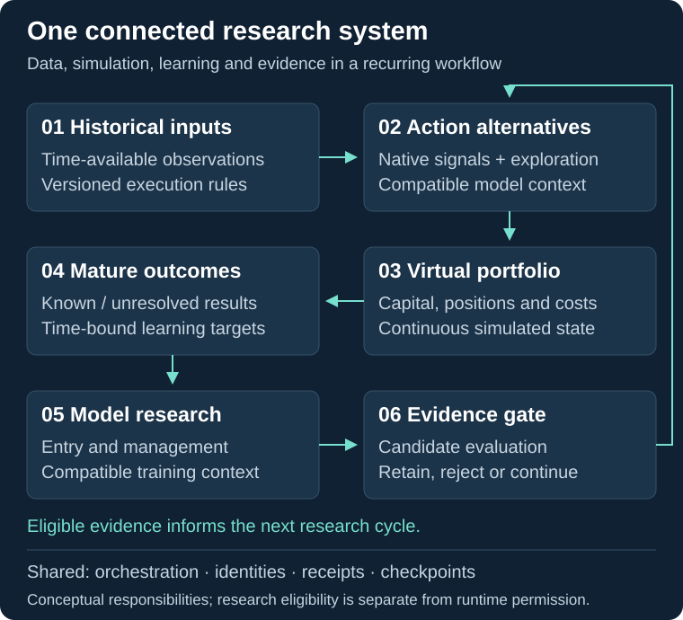

# TradeBot — research, simulation and model evaluation

**A connected platform for investigating decisions, carrying portfolio state and recovering complex research workflows.**

TradeBot brings historical data, strategy evaluation, experimental learning, portfolio accounting and evidence management into one research system. I direct its development from requirements and planning through implementation, acceptance review and continued refinement.

## Engineering scope


[Evidence provenance and scope](docs/engineering-scale.md) · [Verification](docs/verification.md)



## What the platform does

- **Builds a research opportunity set:** native signals, rejected opportunities and optional exploratory actions, including periods without native signals.
- **Maintains a continuous virtual portfolio:** competing allocations, costs, capital, positions and risk state carry across chronological research windows.
- **Connects learning to execution semantics:** model inputs, target definitions and execution assumptions are checked together before reuse.
- **Investigates position management:** holding, closing, protection changes and partial reductions share the historical accounting path.
- **Evaluates candidates:** compatible comparisons and admission checks determine whether a candidate proceeds, an incumbent remains or the system abstains.
- **Recovers verified work:** artifact identities, receipts and checkpoints support restart while preserving completed results.

The engineering challenge is the interaction between these responsibilities. A change in management behavior can change the outcome learned at entry; changing that target can invalidate earlier data and models. [Follow the complete research path](docs/system-walkthrough.md).

## Six implemented engineering achievements

| Achievement | What was built and checked |
|---|---|
| **Continuous state** | Positions, reservations and cash carry across research windows; selected split-run results match whole-run results. |
| **Reconstructable accounting** | Receipts reconstruct simulated cash and preserve the journal across a tested interruption/restart. |
| **Compatible research data** | Targets are bound to execution and management context; the saved audit covers 405,458 modelled action rows. |
| **Durable model completion** | Six interruption points check recovery around fitting, verified saving and completion. |
| **Evidence-dependent admission** | Training, evaluation and authorization have separate meanings; unsupported admission is rejected in selected checks. |
| **Behavior-preserving changes** | Eight baseline-comparison scenarios preserve outputs and byte-identical execution journals. |

The platform also includes data-quality gates, targeted history recovery, resource leases, SQLite workflow memory, large-artifact storage, operator reporting and guarded file replacement. The [20-capability register](docs/implemented-capabilities.md) connects each mechanism to its business relevance and evidence level.

[Detailed engineering cases](docs/engineering-case-studies.md) · [Evidence reference](docs/achievement-evidence.md) · [Architecture and contracts](docs/architecture.md)

## Development across interacting systems

The project history includes explicit architecture decisions, maintained component maps, separation of training and reporting, provenance improvements and integration of continuous historical research. Acceptance criteria cover normal behavior and interruption paths. [Engineering scale and development milestones](docs/engineering-scale.md).

[Development milestones](docs/engineering-scale.md#development-milestones) · [Development methodology](docs/ai-development-workflow.md).

## Run a public example

The standalone receipt-recovery example demonstrates trusted artifact verification, repeat-safe confirmation and rejection of damaged or conflicting records. It uses synthetic input and the Python standard library.

```sh
python -B demo/artifact_receipt.py
python -B -m unittest discover -s demo -p "test_*.py" -v
```

[Demo guide](demo/README.md) · [Current research status](docs/project-status.md)

Explore the architecture and recorded engineering results in this public showcase of the private research platform. [Research status and verification scope](docs/verification.md) documents the evidence behind each claim.

## Discuss a software system

The engineering patterns apply to data platforms, long-running workflows and applications that need traceable state and recovery. [Discuss your requirements](mailto:ivan@matiushkin.com) · [More software projects](https://github.com/Hadezu).
