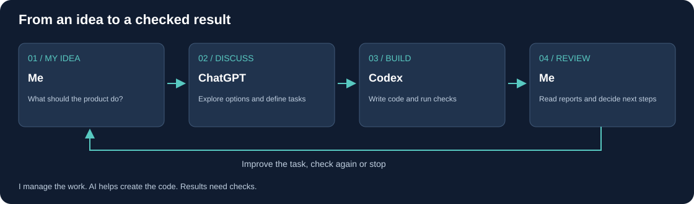

# How I work with ChatGPT and Codex

## The short version

I start with an idea and explain what the product should do. I discuss options with ChatGPT, turn the chosen approach into a clear task and ask Codex to implement it. I then read the reports, ask for tests and decide whether the result is good enough or needs more work.

I also set limits: what must stay unchanged, what evidence is needed and when to stop. When an experiment fails, I ask why before approving another attempt. The code is created with AI assistance; my contribution is managing the work and making product decisions.

The rest of this document explains that process in more detail.

My role is to own the problem and the acceptance criteria while using AI to help design, implement and verify the system. I do not claim to have manually written the entire codebase. This project is an example of long-term AI-assisted product development, including failed experiments and corrections.

## Responsibility is explicit

| Participant | Contribution | Limit |
|---|---|---|
| Owner | Defines goals, priorities, constraints and acceptable evidence; authorizes the next scope | Does not substitute a desired outcome for proof |
| ChatGPT | Helps structure questions, compare approaches and formulate work | Its explanations are hypotheses until supported |
| Codex | Inspects code, implements authorized changes and runs checks | A completion message is not itself acceptance evidence |
| Deterministic verification | Checks contracts, financial invariants, identities and regression behavior | Passing tests establish only their tested scope |

AI-agent orchestration here means directing implementation and review roles through bounded tasks. It does not imply that a collection of autonomous agents has unrestricted authority over trading or infrastructure.

## 1. Translate an ambition into acceptance conditions

A broad request such as “make recovery safe” is too ambiguous to assess. In the actual recovery task, I required the workflow to distinguish a verified saved model from an incomplete artifact, avoid repeated training and preserve identity across restart.

This produced observable acceptance conditions: the number of fit calls, equality of loaded predictions, artifact consistency and rejection of unsupported recovery. The implementation could then be evaluated against behavior rather than the confidence of an explanation.

## 2. Bound the change before implementation

Tasks specified what could change and what had to remain untouched. Existing components were to be reused, old evidence retained and unrelated development deferred. This reduced the chance that a local fix would become an architectural rewrite or that an apparent improvement would come from changing the comparison itself.

The same discipline separated engineering completion from profitability research. Recovery and compatibility could be completed even when the current learning candidate did not demonstrate an advantage.

## 3. Investigate a failure before generating another candidate

The development history included incorrect financial calculations, incompatible assumptions and misleading readiness claims. The response was to request reproducible evidence and locate the defect before continuing dependent experiments.

AI-assisted diagnosis is useful for inspecting code and proposing explanations, but an explanation must remain provisional until checked. A financial discrepancy requires reconciliation; a restart problem requires an interruption test; an admission defect requires rejection tests, including old records.

## 4. Review evidence, not just generated code

The evidence requested depended on the risk of the change:

- For accounting: recorded operations and reconciliation, not only a final result.
- For data: provenance, maturity and compatibility, not only the number of rows.
- For recovery: interrupted and uninterrupted paths, not only a successful first run.
- For model admission: negative cases and a valid rejection path, not only successful training.

The engineering acceptance is a local, AI-assisted verification result. It is not presented as independent professional certification. Private tests remain private, and the public demonstration has a narrower scope.

## 5. Preserve the option to stop

A model that does not show an advantage can remain rejected while the learning infrastructure is considered technically functional. An ambiguous save can require manual recovery. Missing evidence is recorded rather than replaced with an optimistic status.

This helps keep the product goal distinct from any one implementation or hypothesis. The objective is a system that can make and test claims honestly, not a sequence of candidates declared successful because they were produced.

## Example: the complete ownership loop

| Step | Concrete action in the recovery case |
|---|---|
| Problem definition | Identify the gap between artifact saving and completion confirmation |
| Constraints | Extend the existing mechanism; do not silently repeat fit or activate a candidate |
| Implementation | Bind the job to inputs and a verified artifact; preserve fail-closed behavior |
| Verification | Inject six interruption points and test identity, predictions and fit count |
| Acceptance | Accept supported recovery; document the ambiguous window requiring intervention |
| Next decision | Return to research with the reliability constraint addressed, without claiming a better model |

## What employers can assess

The case demonstrates how I structure complex work, maintain boundaries across iterations and insist on measurable outcomes. It supports a discussion of product ownership, requirements engineering and AI-assisted delivery. It does not establish programming depth in every underlying technology, unaided code authorship or trading profitability.

[Detailed engineering cases](engineering-case-studies.md) · [System architecture](architecture.md) · [Evidence limits](verification.md)
