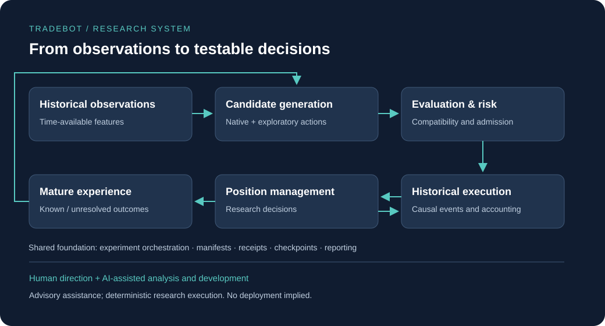

# Architecture and data boundaries

The diagram groups existing responsibilities into conceptual categories. It is not a microservice deployment map. Private module names, trading rules, exact features and infrastructure identifiers are intentionally omitted.

## The research path

| Stage | Input and responsibility | Output and boundary |
|---|---|---|
| Historical observations | Prepare market records and information available at a decision time | Time-bounded features; future outcomes cannot become inputs |
| Candidate generation | Evaluate native strategies and exploratory directional actions | Available alternatives, including the option to abstain |
| Model evaluation | Estimate action outcomes using a compatible research model | Forecasts, not permission to execute |
| Risk and compatibility | Check model/data identities and applicable capital constraints | Accepted research decisions or recorded rejection reasons |
| Historical execution | Apply decisions using causal events and modelled expenses | Position changes and financial records |
| Position management | Re-evaluate an open research position using available observations | Management requests subject to the same executor and protections |
| Outcome maturation | Determine when the action's result is available and sufficiently resolved | Eligible experience or explicit unresolved status |
| Subsequent research | Train and compare candidates chronologically | Evidence for retaining or rejecting a candidate |

An isolated action outcome is not the return of a portfolio. Portfolio execution also accounts for occupied capital, concurrent positions and competing opportunities. Adding individually profitable alternatives together would bypass those constraints.

## Contracts connect the components

The research interfaces bind the version of a model to the meaning of its inputs and targets. Relevant identities include data provenance, feature schema, execution assumptions, management policy and training boundary. These categories are public; their private values are not.

A changed management policy can change an entry's eventual result. The old target therefore does not automatically remain suitable for the new policy. Similarly, a model trained later must not be used as if it had existed earlier in a historical sequence.

Compatibility is checked at handoff boundaries. A failed check is a reason to block the experiment, not an invitation to replace an identifier in a manifest.

## Three different notions of time

1. **Observation time:** when the information used for a decision is available.
2. **Execution time:** the next event at which that decision can be applied under the model.
3. **Outcome availability:** when the result becomes mature enough for subsequent learning.

Keeping these separate prevents a completed candle from authorizing an earlier fill and prevents later trade outcomes from leaking into earlier training. These are causal requirements; they do not imply that historical market data completely identifies execution.

## Management and financial responsibility

Position-management decisions feed the existing historical executor rather than a separate accounting implementation. Protection levels and risk constraints retain priority. Interfaces exist for holding, closing, changing protection and reducing a position; learned selection is not equally complete for all four.

The distinction matters: verifying the financial consequence of a partial reduction does not prove that a model knows when to request one. Current learned management remains experimental, with no demonstrated advantage asserted here.

## Cross-cutting reliability

Experiment orchestration coordinates the workflow. Manifests record compatible inputs and versions; receipts record completed operations; checkpoints support restart. Recoverable state must refer to the same proven artifacts rather than whichever files happen to be present.

Reporting preserves both successful and rejected work. Unresolved results remain explicit. A completed fit does not imply admission, and a research comparison does not imply automatic deployment.

## AI and the human owner

ChatGPT and Codex assist analysis and software development. The project also contains advisory analysis components, but their existence alone does not demonstrate effectiveness. Deterministic checks govern research execution and validation. Human authorization defines the permitted scope of development and any later promotion decision.

## Verified scope and remaining limits

Data preparation, compatibility checks, causal execution, accounting and supported recovery paths have selected regression evidence. Learned entry quality and position-management advantage remain experimental or NOT VERIFIED. The public presentation contains no runtime access and does not reproduce the private implementation. See [verification](verification.md) and [current status](project-status.md).
