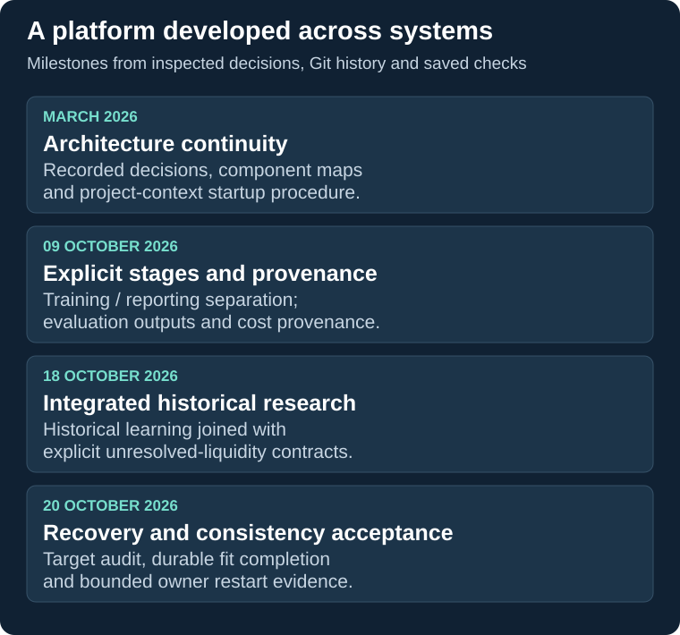

# Engineering scale and development record

This record connects the platform's capabilities to inspected implementation, history and saved acceptance. Review date: **23 October 2026**. Private source inspection was read-only; the application, experiments and private test suites were not executed for this presentation.

## Connected subsystems

| Responsibility | Interaction that makes the system substantial | Evidence basis |
|---|---|---|
| Research orchestration | An existing cycle owner coordinates experiment records, candidate context and governed review; bounded workers run validation | Inspected cycle/runner integration, explicit proposal checks and timeout handling |
| Historical materialization | Observations and action alternatives become targets bound to execution assumptions | Saved target audit and inspected execution-contract validation |
| Continuous portfolio simulation | Positions, reservations, cash and costs carry across windows; competing opportunities share capacity | Inspected split-versus-continuous execution and receipt-reconciliation regression tests |
| Entry and management research | Management changes affect entry outcomes, requiring compatible model and target identities | Inspected management handoff and target contracts |
| Artifact recovery | Fit, verified save, commitment and job completion are distinct stages | Saved six-point failure-injection results and corresponding test implementation |
| Evidence and admission | Results, provenance and evaluation determine candidate eligibility | Inspected rejection paths; saved acceptance and restart evidence |

These are responsibilities within an evolving application, not a count of independently deployed services. Static code and dependency maps help navigate the project; they are not dynamic coverage measurements.

## Quantified engineering evidence

**Research scope:** the documented historical protocol evaluates nine markets and 21 native strategies. This describes the breadth of the research configuration.

**Target audit:** the saved 20 October acceptance and machine-readable target audit agree on **405,458 modelled action rows**, across **126 completed partitions**. The audit records completed processing, reconciliation and control replay work. These are simulated alternatives, not executed exchange trades or independent statistical samples. No performance result is inferred from their count.

**Acceptance:** saved XML contains 282 cases: **280 passed, zero failures/errors and two skipped** across the selected suites. These are historical results for their recorded scope. The two skipped placeholders remain skips; separate saved owner/restart evidence is described separately.

**Recovery:** the small real-fit tests inject failure before fitting, during save, after verified save, after commitment, after checkpoint and after completion. Assertions cover fit count, restored predictions, artifact identity and preservation of financial evidence. The ambiguous save window stops for manual recovery; supported paths finish the existing verified job.

**Orchestration restart:** a saved owner-restart record reports unchanged receipt identities, no duplicate fit and no duplicate receipts in its bounded experiment. This corroborates a specific workflow restart, not an unattended-production uptime claim.

## Development milestones

| Period | Engineering change | Why it matters |
|---|---|---|
| March 2026 | Recorded decisions introduced persistent architecture/dependency maps and a project-context startup procedure | Maintain continuity and navigate the effects of changes across a large codebase |
| October 2026: separation and provenance | Git history records separation of training/report assembly, evaluation/output stages and cost provenance improvements | Give stages explicit responsibilities and make results traceable |
| October 2026: integrated historical research | Research-branch history records historical learning and explicit unresolved-liquidity contracts | Connect learning, simulation and uncertainty handling within the research workflow |
| 20 October 2026: acceptance closure | Saved evidence covers target compatibility, durable fit completion and bounded owner restart | Turn requirements into observable recovery and consistency checks |

Milestones summarize inspected records. A commit subject is evidence of a recorded change, not proof that every operating mode passed acceptance. The current working research branch includes uncommitted changes; the public account does not treat old default-branch code as the current implementation.

## Verification scope

The source, datasets and full acceptance artifacts remain private. Their reported results cannot be reproduced from this showcase. Public reproduction covers the separately authored seven-test receipt example.

The demonstrated reliability is specific: compatible targets, reconciled simulated state and supported interruption/restart behavior. Production readiness, universal recovery and profitable model performance have not been established. Learned selection for protection changes and partial reductions remains incomplete, while their execution/target interfaces have selected regression evidence. Historical research acceptance does not close separate PAPER runtime issues.

[Architecture](architecture.md) · [Case studies](engineering-case-studies.md) · [Verification](verification.md) · [Research status](project-status.md)
